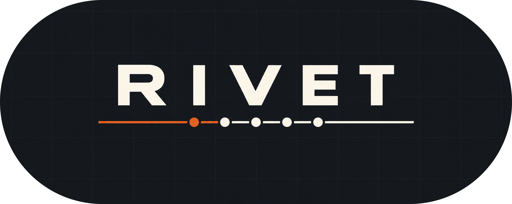

<div align="center">



<p>A development workflow for AI coding agents.</p>

<p>
  <a href="https://opencode.ai/"></a>
  <a href="https://www.python.org/"></a>
  <a href="./LICENSE"></a>
</p>

</div>

Rivet gives your agent a repeatable path from understanding the codebase to
shipping a verified change. It is opinionated on purpose. The workflow is the
product.

## Quick start

Rivet needs macOS, Linux, or WSL, plus Git, Python 3.9+, and OpenCode V2.

```bash
# Install Rivet
curl -fsSL https://raw.githubusercontent.com/DuckKota/rivet/main/installer/run | bash

# Initialize a project
cd my-project
rivet init
```

`rivet init` is safe to run again. It inspects the project, installs or
reconciles what is missing, and leaves your own configuration alone.

Check the result:

```bash
rivet status
```

If anything needs attention, `rivet status` lists the exact changes and the
command to fix them.

## The workflow

| Stage | Command | What it does |
| --- | --- | --- |
| Sharpen | `/grill-me` | Stress-test the idea before committing to it. |
| Spec | `/opsx-propose` | Turn the idea into an OpenSpec change with design, specs, and tasks. |
| Refine | `/opsx-refine` | Second planning pass: catch gaps, cut over-engineering. |
| Plan review | `/plannotator-annotate` | Annotate the plan before implementation. |
| Implement | `/opsx-apply` | Work through the change's tasks. |
| Review | `/ponytail-review` | Cut over-engineering from the diff. |
| Close | `/opsx-archive` | Archive the completed change. |
| Commit | `/commit-message` | Generate a Conventional Commit message; `verify-commit` validates it. |

Bug fixes skip the ceremony. The fix is already scoped, so it is the spec. Run
`/fix`, then `/ponytail-review`, then `/commit-message`. If the bug is
architectural — it spans subsystems, needs design decisions, or is a refactor
in disguise — enter the feature flow at `/opsx-propose`.

## Commands

| Command | What it does |
| --- | --- |
| `rivet init` | Initialize or reconcile Rivet in the current project. |
| `rivet status` | Show the current installation state and what needs attention. |
| `rivet update` | Update Rivet itself, then reconcile the project. |
| `rivet uninstall` | Remove Rivet-managed configuration, keeping user files. |

Useful flags:

```bash
rivet init --dry-run      # show the plan, change nothing
rivet init --force        # back up and replace conflicts, prune stale links
rivet init --no-project   # global configuration only
rivet init --verbose      # show every file and subprocess

rivet update --dry-run    # check for updates without applying them
rivet update --force      # apply updates, backing up conflicts

rivet uninstall --dry-run # show what would be removed
```

`rivet init`, `rivet status`, `rivet update`, and `rivet uninstall` are
project-aware. Run them from anywhere inside a Git repository; Rivet resolves
the root for you.

## Bundled integrations

Rivet installs four integrations. Magic Context is the only manual one: run the
setup command the installer prints, and `rivet status` reports whether it is
installed.

| Integration | What it adds |
| --- | --- |
| [Ponytail](https://ponytail.dev/) | Lazy-senior review and implementation discipline |
| [Plannotator](https://plannotator.ai/) | Plan and code annotation UI |
| [HeadsUp](https://github.com/charlesnutter/opencode-headsup) | Inference telemetry in the sidebar |
| [Subagent Statusline V2](https://github.com/roboalchemist/opencode-subagent-statusline-v2) | Subagent tree and status footer |
| [Magic Context](https://github.com/cortexkit/magic-context) | Long-session context management (manual setup) |

## Under the hood

`rivet` is a small CLI backed by a Git checkout. By default it lives at
`~/.rivet` and registers a `rivet` shell function.

Rivet also installs the skills the workflow invokes, so the agent loads the
right discipline without you naming it.

`rivet init` does three things:

1. **Installs core configuration.** Commands, skills, instructions, themes, and
   plugins are linked into the OpenCode config directory. Files that need
   substitution are written as managed copies.
2. **Initializes the project.** OpenSpec is set up in the repository, and
   Codebase Memory gets its instructions, reminder plugin, MCP server entry,
   and initial graph index.
3. **Verifies the result.** Anything that still needs attention is reported
   with a next step.

The manifest (`manifest.toml`) is the source of truth for every core artifact.
`rivet init --dry-run` compares the manifest with what is on disk, so you can
see the change before it happens. `rivet uninstall` removes only files that
still match what Rivet wrote; modified files are preserved and reported.
Managed copies are recorded by hash in `.rivet-state.json`, and `--force`
copies conflicts into `.rivet-backups/` before replacing them.

`rivet update` pulls the Rivet checkout, then re-runs `rivet init` in a fresh
process so new code takes effect immediately.

## Development

```bash
pip install -r requirements.txt

pytest tests/ -q
mypy src/
pylint src/

./installer/test-installer   # end-to-end installer test in an isolated HOME
```

See [MAINTAINING.md](./MAINTAINING.md) for provenance, vendoring, and the
per-artifact notes. OpenSpec changes live under `openspec/`.

## License

Apache 2.0. See [LICENSE](./LICENSE).
